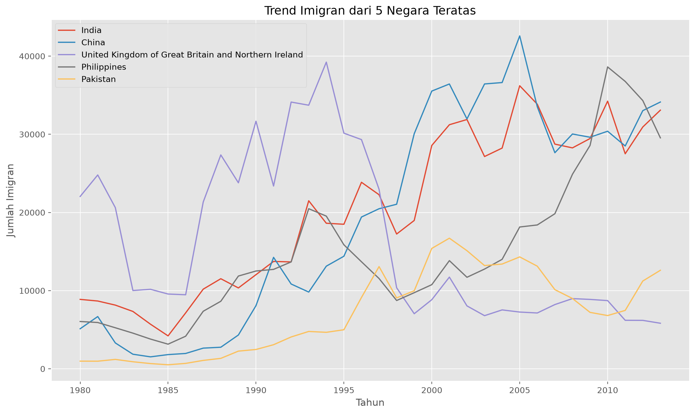

# Modul 1: Introduction to Data Visualization Tools

Modul pengantar dari course IBM Data Visualization with Python. Isinya dasar visualisasi data dan cara membuat line plot dengan Matplotlib dan Pandas.

## Yang dipelajari
- Fungsi visualisasi data
- Cara kerja Matplotlib secara garis besar
- Menyiapkan data dengan Pandas
- Membuat dan menyimpan line plot

## Dataset
[Nama dataset, periode, dan sumber sesuai materi course]

## Hasil


Temuan singkat:
- [Lima negara teratas sesuai keluaran notebook]
- [Pola tren yang terlihat pada grafik]

## Struktur folder
```
module-1-intro-visualization-tools/
├── README.md
├── cheatsheets.md
├── notebooks/
└── outputs/
```

## Pelajaran penting
- `savefig()` ditulis sebelum `show()`.
- Tahun diubah menjadi angka agar sumbu x terurut.
- Data di-transpose agar tahun menjadi indeks.